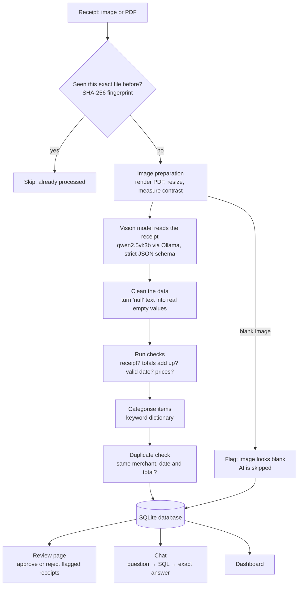

# AI Expense Tracker

Upload a photo or PDF of a receipt, and a local AI model reads it, turns it into a structured expense record, checks its own work, and flags anything it isn't sure about for a human to review. You can then ask questions about your spending in plain English, by typing or by voice, and see it all on a dashboard.

**Everything runs on your own computer.** No cloud AI service is used, so receipts and spending data never leave your machine.


---

## Table of contents

- [Features](#features)
- [How it works](#how-it-works)
- [Project structure](#project-structure)
- [Tech stack](#tech-stack)
- [Installation](#installation)
- [Usage](#usage)
- [Design decisions and lessons learned](#design-decisions-and-lessons-learned)
- [Evaluation](#evaluation)
- [Limitations and future work](#limitations-and-future-work)
- [Privacy](#privacy)

---

## Features

- **Receipt scanning**: upload a JPG, PNG or PDF receipt; a vision-language model extracts the merchant, address, date, items (with quantities) and total
- **Automatic checks**: verifies that the item prices add up to the total, that the date is valid and not in the future, that prices are plausible, and that nothing important is missing
- **Hallucination defence**: blank images are caught before the AI runs, and images that aren't receipts are detected from the evidence, not just the model's own opinion
- **Duplicate detection**: identical files are recognised instantly by their fingerprint, and the same purchase scanned twice is flagged by comparing merchant, date and total
- **Human-in-the-loop review**: anything flagged waits for a person to approve or reject it; only approved receipts count towards your spending
- **Item categories**: every item gets an English name and a category (dairy, snacks, drinks…) from a keyword dictionary built for abbreviated German receipt names
- **Chat with your expenses**: ask questions like _"How much did I spend at Kaufland?"_ or _"How much did I spend on sweets?"_; the AI writes a database query, and the database calculates the exact answer
- **Voice**: ask questions by speaking (local Whisper speech recognition) and have answers read aloud (browser text-to-speech)
- **Dashboard**: spending per month, per category and per store, plus your top items

---

## How it works



### Step by step

1. **Fingerprint.** The uploaded file's SHA-256 hash is compared with all previous uploads. An identical file is skipped immediately, before any slow AI work.
2. **Image preparation.** PDFs are rendered into images (multi-page receipts are stacked into one tall image). Every image is resized so its longest side is at most 1500 pixels, which keeps it within the model's context window. The image's contrast is measured: a nearly uniform image is blank, so the AI is skipped and the receipt is flagged.
3. **Extraction.** The image is sent to a local vision-language model with a strict schema (built with Pydantic). The model can only answer in that exact shape: numbers where numbers belong, `true`/`false` for "is this a receipt?", and so on. Temperature is set to 0 for consistent results.
4. **Cleaning.** The model sometimes writes `"null"` as text instead of a real empty value, or invents placeholder items. These are normalised.
5. **Checks.** Code, not the AI, verifies the result. Each problem becomes a human-readable flag.
6. **Categorisation.** Each item gets an English name and a category from a keyword dictionary.
7. **Duplicate check.** A different file showing the same purchase (same merchant, date and total) is flagged as a possible duplicate.
8. **Saving.** Receipts and items are stored in SQLite. Receipts without flags are approved automatically; flagged ones wait for review.

The chat and dashboard only ever use **approved** receipts.

---

## Project structure

```
├── app.py                  Main page: upload, review flagged receipts, list all receipts
├── pages/
│   ├── 1_Ask.py            Chat page with voice input and read-aloud answers
│   └── 2_Dashboard.py      Spending charts and key numbers
├── pipeline.py             Connects all steps: one file in, one checked result out
├── image_prep.py           PDF rendering, resizing, contrast measurement, file fingerprint
├── extractor.py            Schema, prompt and call to the vision model
├── checks.py               Data cleaning and all validation checks
├── categorizer.py          Keyword dictionary: English names and categories for items
├── database.py             SQLite tables, migrations, saving and duplicate lookups
├── ask.py                  Chat brain: question → SQL → read-only query → answer
├── voice.py                Local speech-to-text with Whisper
├── categorize_existing.py  One-off script: label items saved before categories existed
├── eval_categories.py      Evaluation script for the categorizer
├── eval/
│   └── category_labels.json  Hand-labelled test items
├── show_expenses.py        Small terminal viewer for the database
├── experiment/             The step-by-step scripts the project was built from
└── requirements.txt
```

Each module has one job, and modules talk to each other through small functions such as `handle_receipt(path)` and `ask(question)`. That made it possible, for example, to replace the AI-based categorizer with a keyword dictionary by changing a single file.

---

## Tech stack

| Purpose | Tool |
|---|---|
| Vision-language model (reading receipts, writing SQL) | [Qwen2.5-VL 3B](https://ollama.com/library/qwen2.5vl) |
| Running models locally | [Ollama](https://ollama.com) |
| Structured output and validation | [Pydantic](https://docs.pydantic.dev) |
| Image processing | [Pillow](https://python-pillow.org) |
| PDF rendering | [PyMuPDF](https://pymupdf.readthedocs.io) |
| Speech-to-text | [faster-whisper](https://github.com/SYSTRAN/faster-whisper) (Whisper "tiny", int8) |
| Text-to-speech | Browser Web Speech API |
| Database | SQLite |
| Web interface and charts | [Streamlit](https://streamlit.io), pandas |

---

## Installation

### Requirements

- Python 3.10 or newer
- [Ollama](https://ollama.com/download)
- About 4 GB of free disk space for the models
- At least 8 GB of RAM (see [Limitations](#limitations-and-future-work)). An NVIDIA GPU is used automatically if available and the driver is recent enough.

### Setup

```bash
# 1. Get the code
git clone https://github.com/Akshay-R-7/Expence-Tracker.git
cd Expence-Tracker

# 2. Download the vision model (about 3 GB)
ollama pull qwen2.5vl:3b

# 3. Create and activate a virtual environment
python -m venv venv
venv\Scripts\activate          # Windows
# source venv/bin/activate     # macOS / Linux

# 4. Install the Python libraries
python -m pip install -r requirements.txt
```

The Whisper speech model (about 75 MB) downloads automatically the first time you use voice input.

### Run

Make sure Ollama is running, then:

```bash
streamlit run app.py
```

The app opens at `http://localhost:8501`. The database file `expenses.db` is created automatically on first use.

---

## Usage

### In the browser

1. **Scan a receipt** on the main page: upload a JPG, PNG or PDF and click _Scan receipt_. Scanning takes roughly a minute on a CPU.
2. **Review flagged receipts**: each one shows its flags and the receipt image. Approve it if it's correct, reject it if it's a duplicate or not a receipt.
3. **Ask questions** on the _Ask_ page: type, or record a question in the sidebar. Under each answer, _How I found this_ shows the exact SQL query and database result, and _Read aloud_ speaks the answer.
4. **See your spending** on the _Dashboard_ page, for all time or a single month.

### From the terminal

```bash
python pipeline.py receipts/my_receipt.jpg      # scan one receipt
python ask.py How much did I spend on drinks?   # ask a question
python voice.py my_question.m4a                 # test speech recognition
python show_expenses.py                         # view the database
python eval_categories.py                       # evaluate the categorizer
python categorize_existing.py --all             # re-label all items
```

### Example questions

- How much did I spend in total?
- How much did I spend at Kaufland?
- How much did I spend this month?
- What was my most expensive item?
- How much did I spend on eggs?
- How much did I spend on sweets?
- How many receipts are waiting for review?

---

## Design decisions and lessons learned

This project was built step by step, and most design decisions came directly from a failure observed along the way.

### The AI extracts, code verifies

The model is good at reading, but it doesn't know when it has made a mistake. Anything with a definite right answer is therefore checked by code: whether prices add up to the total, whether the date is valid, whether a result is empty. Even in the chat, the AI writes the query, but the database does the arithmetic.

### Money is stored in cents

Adding the twelve prices on a test receipt in Python gave `15.100000000000001` instead of `15.10`, so the total check failed on a correct receipt. Decimal numbers like 0.1 can't be represented exactly in binary. All amounts are therefore stored as whole cents (`1510`), which are exact, and only converted to euros for display.

### A blank image produced an entire invented receipt

Given a completely white image, the model returned a believable receipt from "The Store, 123 Main St, Anytown USA" with apples, bananas and oranges, whose prices even added up correctly. Checks can verify that data is **consistent**, but not that it's **true**. Two defences were added:

- **A contrast gate before the AI.** A blank image has almost no variation in pixel values (contrast 0.0, compared with about 44 for a real receipt), so the AI isn't run at all.
- **An evidence check after the AI.** A photo of a car was confidently classified as a readable receipt by the model itself, after it read the number plate as a store name. So the system doesn't rely on the model's own `is_receipt` answer: a "receipt" with no items and no total is flagged regardless of what the model claims.

### Strict schemas enforce types, not meaning

Structured output guarantees that a price is a number. It can't stop the model writing the text `"null"` in a text field, so a separate cleaning step turns such values into real empty values. The schema and the cleaning step catch different problems, which is why both are kept.

### Duplicates at two levels

The same file uploaded twice is caught instantly by its fingerprint, before the AI runs. The same purchase uploaded as a different file (a photo and a PDF of one receipt) can only be caught by comparing content, so it's **flagged** rather than blocked, because two genuinely identical purchases are possible.

### Text-to-SQL instead of pasting data into the prompt

The chat never shows your data to the model. It only describes the table structure, and the model translates the question into a SQL query. This keeps working however many receipts you have, and the database calculates totals exactly. Making it reliable with a small model took several steps:

- **Few-shot examples** showing correct queries, deliberately using different stores and products than the test questions, so the tests stay meaningful
- **Grounding**: the real store names from the database are included in the prompt, so the model knows "kaufland" is a store, not a product
- **A self-correction loop**: if a query fails, the error is sent back to the model to fix, up to three times
- **Code decides when nothing was found**: the model was offered "say nothing was found" as an option and took it even when the result contained the answer, so that decision moved into code

### Safety: the model tried to delete the data

Asked to "delete all my receipts", the model wrote `DELETE FROM receipts`, three times in a row. It was blocked because the chat's database connection is **read-only**: whatever SQL the model writes, that connection physically cannot change data. A check for `SELECT` queries gives a clear message early, but the read-only connection is the real protection.

### Replacing the AI categorizer with a keyword dictionary

The first categorizer used the vision model. Every prompt change fixed one item and broke another: chips labelled as meat because of the word "chicken", tomato sauce as a drink, identical items labelled differently depending on what else was in the same batch. It was replaced by a keyword dictionary: instant, consistent, explainable, and offline. Rule order matters, since the first match wins: "Zahnpasta" (toothpaste) contains "pasta", "Lays KFC Chicken" contains "chicken", and "Schweinefilet" (pork) contains "wein" (wine), so specific rules come before general ones.

### Fitting several models into 8 GB of RAM

On the development laptop (8 GB RAM), the vision model and the speech model couldn't be in memory at the same time, and every failure showed up as "failed to allocate memory". The models now **take turns**: Whisper is unloaded right after transcribing, and Ollama unloads the language model after answering. The context window was also reduced back to 4096 tokens once automatic resizing made the larger window unnecessary.

---

## Evaluation

### Categorizer

`eval_categories.py` runs the categorizer on hand-labelled items in `eval/category_labels.json` and reports accuracy.

| Approach | Accuracy | Time for 25 items |
|---|---|---|
| Vision model (`qwen2.5vl:3b`) | inconsistent; see lessons above | tens of seconds |
| Keyword dictionary | 25 / 25 | under 1 ms |

**Important caveat:** the keyword rules were written while looking at these same 25 items, so this score is overfitted and doesn't show how well the rules work on new receipts. A fair test needs items from receipts the rules have never seen.

### Receipt extraction

_To do: a labelled set of receipts with the correct merchant, date, total and items, measuring field-level accuracy and processing time._

---

## Limitations and future work

**Known limitations**

- **Memory.** On 8 GB of RAM, scanning, chat and voice have to take turns, and other programs may need to be closed.
- **Speed.** On a CPU, scanning one receipt takes about a minute. Using a GPU should be much faster.
- **The keyword dictionary only knows the words it contains.** Unknown items are labelled "other" until keywords are added.
- **Follow-up questions.** Each chat question is answered on its own, so "and what about there?" doesn't work yet.
- **Date format.** Dates are expected in the German format `DD.MM.YY`; other formats are flagged.
- **Tested mainly on German supermarket receipts.**

**Ideas for future work**

- Edit extracted values during review instead of only approving or rejecting
- An evaluation set of real receipts with field-level accuracy numbers
- Read text directly from digital PDFs instead of rendering them to images
- Compare the extracted values with a second, independent OCR tool to catch invented text
- Send recent conversation history with each chat question to support follow-ups
- Handle items sold by weight (for example `0,734 kg x 2,99 €/kg`)
- Export approved expenses to Excel or CSV
- A "restore" option for rejected receipts

---

## Privacy

All processing happens locally: the AI models run through Ollama and faster-whisper on your own computer, and data is stored in a local SQLite file. Your database, receipts and voice recordings are listed in `.gitignore`, so they are never uploaded to the repository.

---

## Author

Built by [Akshay-R-7](https://github.com/Akshay-R-7) as a hands-on project to learn how to build a reliable application around local AI models.